<p align="center">
  
</p>

<h1 align="center">Stoa</h1>
<p align="center"><i>agentic trading</i></p>

**Open-source platform for trading through agentic systems (agentic trading).**

[Русская версия](README.ru.md) | License: MIT | Roadmap: [docs/ROADMAP.md](docs/ROADMAP.md)

Stoa gives one or more LLM agents (the "brain") fixed roles: `entry_scout`, `position_manager`, `reviewer`, `day_auditor`, `morning_analyst`, `news_reader`. The platform feeds them market data, metrics and a fixed set of exchange tools. A deterministic executor is the only holder of the trading key and checks every plan against hard limits (guard, Gate, KILL). After each trading day a review is written, and a case memory accumulates experience for the next days. It runs on Bybit USDT perpetual futures; the default profile is **paper**.

> **Disclaimer.** Experimental software, not financial advice. **Profitability is not proven**: our own research (`docs/RESEARCH.md`) found no rule-based edge that survives costs and robustness checks. Leveraged perpetual futures can lose a whole deposit quickly. Paper is the default; live trading is an explicit, gated owner decision. Provided "as is", without warranty (`LICENSE`). Full text at the end.

## How it works

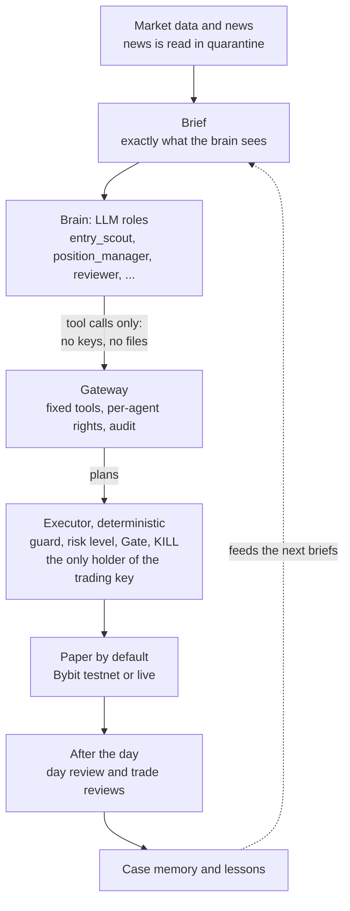

- **Agents.** Each role is an LLM call with its own prompt, schema, budget and fallback model. Any provider: DeepSeek and Anthropic natively, OpenAI-compatible APIs (OpenAI, Gemini, Groq, Mistral, OpenRouter) and local models (LM Studio, Ollama). Details: `docs/ROLES.md`, `docs/BRAIN.md`, `docs/PROVIDERS.md`.
- **Executor.** Places every order with a stop and a take-profit, watches positions on a one-second scale, computes size, leverage and margin in code from capital and the owner's risk level (1-5). A stop can only be tightened. No averaging down, no martingale. `state/KILL` halts trading and only a human clears it. Details: `docs/ARCHITECTURE.md`, `docs/RISK_LEVELS.md`, `docs/CONTROL.md`.
- **Tools, not access.** The brain never sees keys, files or the shell: only the tool gateway with per-agent rights (`docs/GATEWAY.md`). Third-party text (news, headlines) is data, never instructions (`docs/NEWS.md`).
- **Memory and measurement.** Every trade lands in the journal; hypotheses are counted as experiments (n, mean R, multiple-comparison correction); cases and lessons feed later briefings. Where this is going: `docs/ROADMAP.md`.

## Quick start

One command per OS. It checks the environment, offers to install what is missing (Python included), sets up paper mode and an optional LLM provider, then starts the platform and the dashboard. Nothing is installed without an explicit `[Y/n]` and the exact command shown first.

```bash
git clone https://github.com/ciel69/stoatrade.git
cd stoatrade
./tb setup            # macOS, Linux, WSL
```

```powershell
git clone https://github.com/ciel69/stoatrade.git
cd stoatrade
.\tb.cmd setup        # Windows (cmd or PowerShell)
```

Then open **http://127.0.0.1:8765/** (local only) and press **«Начать торговлю»** at the top of the sidebar, mode `paper`. Later starts: `./tb start`, `./tb stop`, `./tb status` (Windows: `.\tb.cmd ...`).

What `setup` checks and does, and the flags `--check`, `--yes`, `--dry-run`, `--no-start`: [docs/QUICKSTART.md](docs/QUICKSTART.md) (Russian). Requirements in short: Python 3.9+ (installed for you if missing), the `websockets` package for the dashboard (offered via pip), internet access to public Bybit endpoints. Node.js is **not** needed: the built dashboard (`frontend/dist`) is in the repository. No exchange key is needed for paper; an LLM key is optional.

## Screenshots

Demo data, not a real account (`frontend/e2e/lib/demo.mjs`; how to regenerate: `docs/images/README.md`). The UI is in Russian. Screenshots follow your GitHub theme (dark or light).

### Overview

Money strip, room to the limits, open positions with stop and take, cumulative PnL, what the brain is doing, limit orders, plans in work.

<picture>
  <source media="(prefers-color-scheme: light)" srcset="docs/images/overview-light.png">
  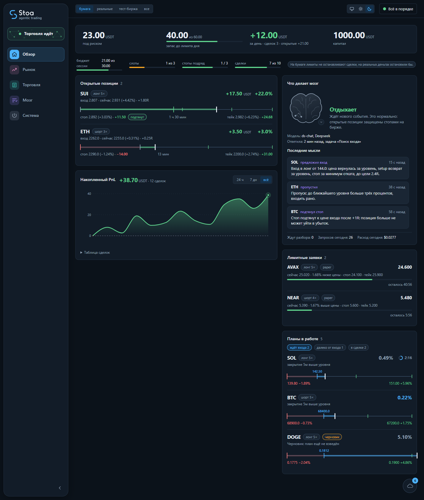
</picture>

### Brain → Decisions

Every decision of the roles and the executor, rejects with reasons, result per model against its LLM cost.

<picture>
  <source media="(prefers-color-scheme: light)" srcset="docs/images/brain-decisions-light.png">
  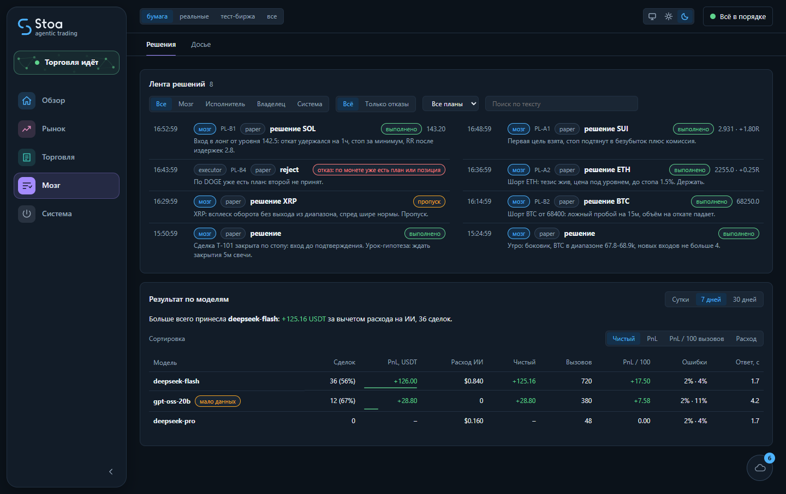
</picture>

### System → Control

Platform state, risk level, nodes, session with loss budget, room to each limit, capital.

<picture>
  <source media="(prefers-color-scheme: light)" srcset="docs/images/control-light.png">
  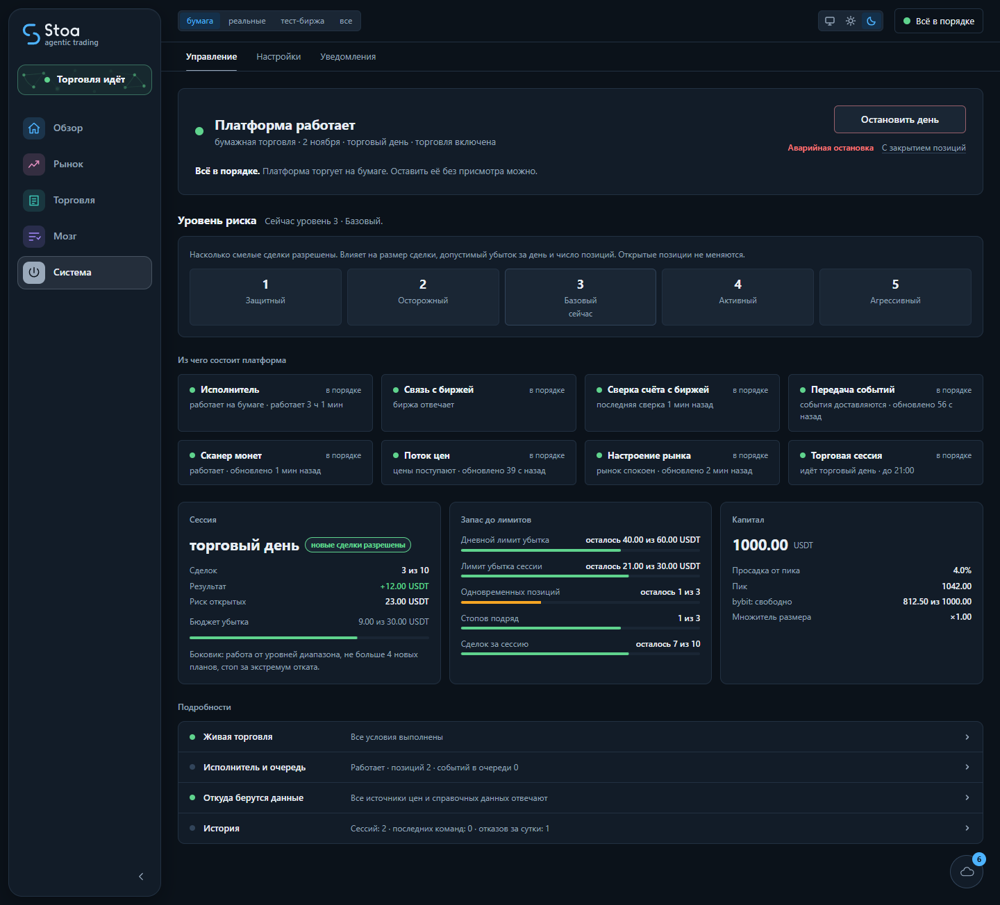
</picture>

<details>
<summary><b>More screens</b> (8)</summary>

### Trading → Plans

Waiting for entry, far, in trade, closed; distance to the trigger.

<picture>
  <source media="(prefers-color-scheme: light)" srcset="docs/images/plans-light.png">
  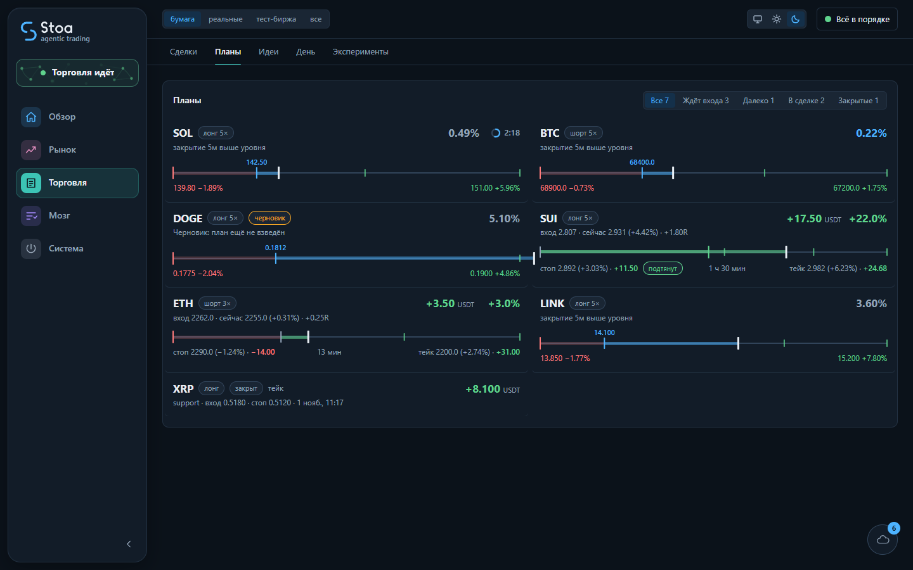
</picture>

### Trading → Trades

Cumulative PnL, history, PnL per trade, exit reasons, error tags from reviews.

<picture>
  <source media="(prefers-color-scheme: light)" srcset="docs/images/trades-light.png">
  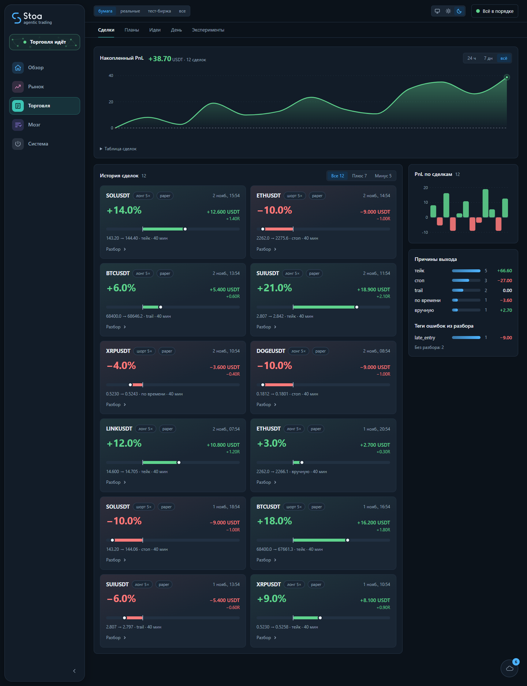
</picture>

### Trading → Day

Start steps of the trading day, day plan, carried positions, previous days with results.

<picture>
  <source media="(prefers-color-scheme: light)" srcset="docs/images/day-light.png">
  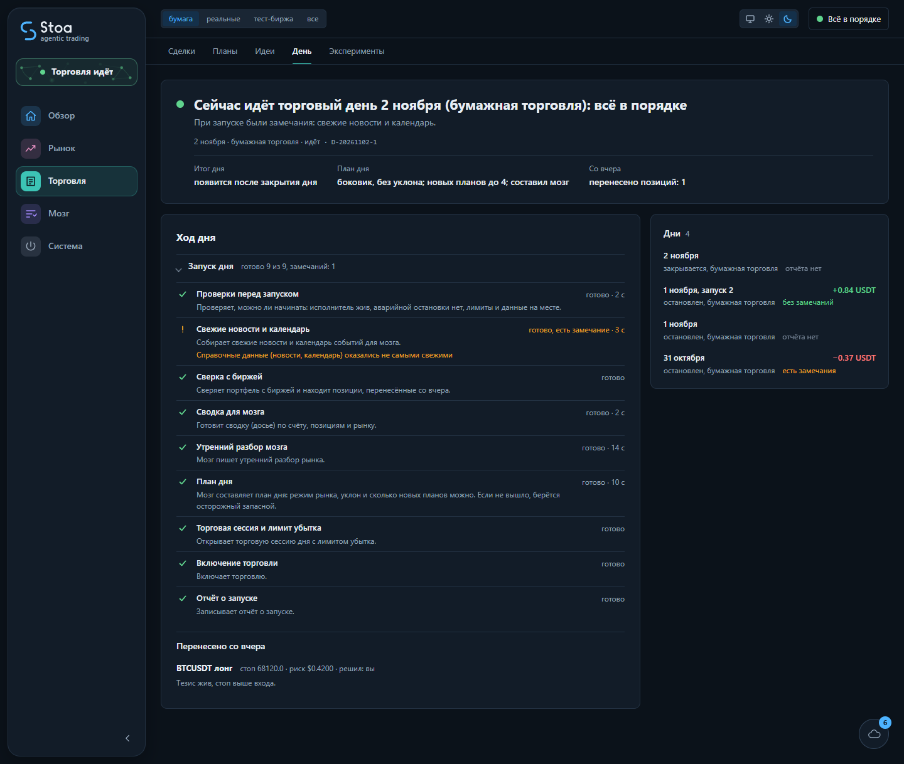
</picture>

### Trading → Experiments

Hypotheses with n, mean R, win rate and "too little data" flags.

<picture>
  <source media="(prefers-color-scheme: light)" srcset="docs/images/experiments-light.png">
  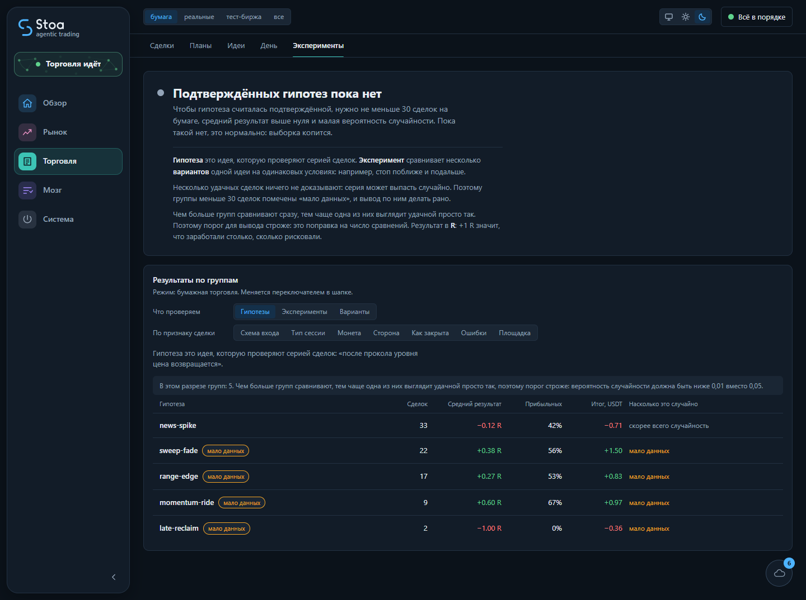
</picture>

### Brain → Brief

Exactly what the brain sees: account, room, positions, plans, market, limits, LLM cost of the day, hot coins, levels, lessons.

<picture>
  <source media="(prefers-color-scheme: light)" srcset="docs/images/brief-light.png">
  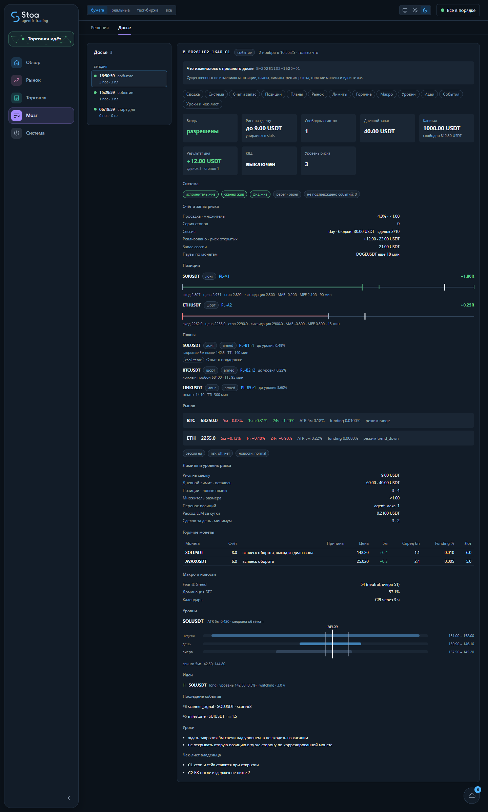
</picture>

### System → Settings

Which model serves which role, providers and exchange, LLM spend and ceilings.

<picture>
  <source media="(prefers-color-scheme: light)" srcset="docs/images/settings-light.png">
  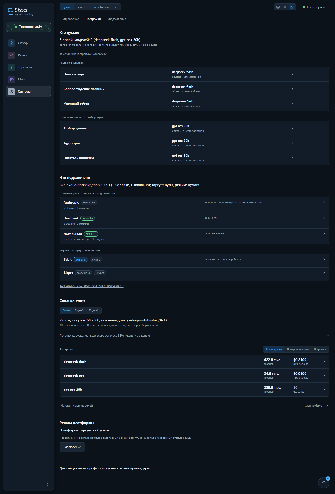
</picture>

### Market

Map of coins.

<picture>
  <source media="(prefers-color-scheme: light)" srcset="docs/images/market-light.png">
  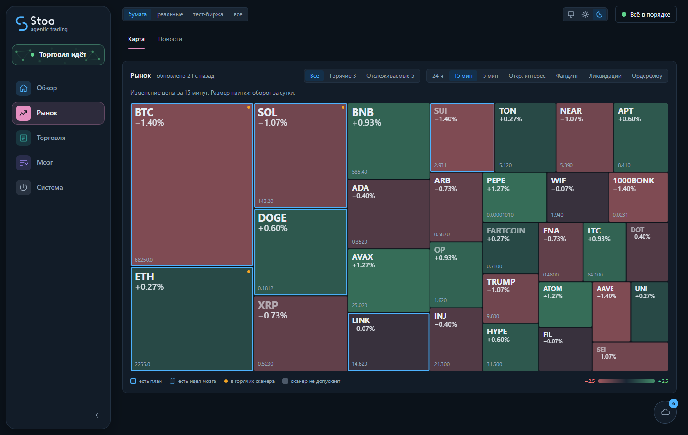
</picture>

### Event panel

Live events from the bus.

<picture>
  <source media="(prefers-color-scheme: light)" srcset="docs/images/events-light.png">
  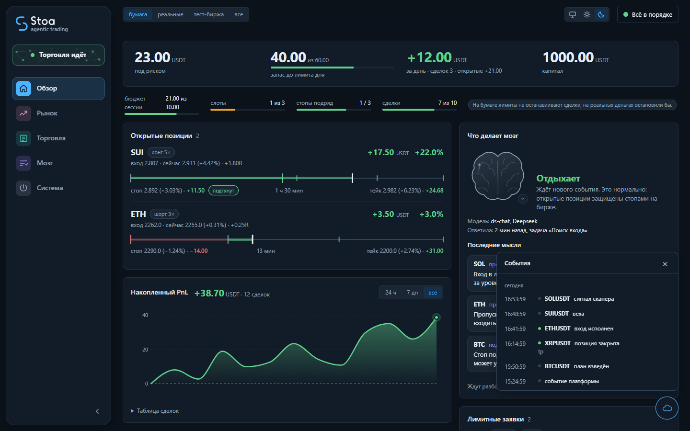
</picture>

</details>

## Documentation

| | |
|---|---|
| [docs/QUICKSTART.md](docs/QUICKSTART.md) | first run, `setup`, start, dashboard, stop, troubleshooting |
| [docs/PROVIDERS.md](docs/PROVIDERS.md) | connect an LLM provider (cloud or local), profiles, roles, budgets |
| [docs/EXCHANGES.md](docs/EXCHANGES.md) | exchange keys (Bybit only), testnet, live gates |
| [docs/WINDOWS.md](docs/WINDOWS.md) | Windows specifics |
| [docs/ROADMAP.md](docs/ROADMAP.md) | development direction: the learning brain, stages 0-6 |
| [docs/INDEX.md](docs/INDEX.md) | everything else: architecture, gateway, control plane, risk levels, lifecycle, research |

Tests: `./tb test` (unittest, no network, no real keys). Contributing: `CONTRIBUTING.md`; security: `SECURITY.md`; before publishing a fork: `./tb audit-public`. Most documents are in Russian.

## Disclaimer

- **Experimental software. Not financial advice.** Nothing here is a recommendation to buy, sell or hold anything.
- **Profitability is NOT proven.** The research in this repository (`docs/RESEARCH.md`) tested rule-based strategies and found no edge that survives costs and robustness checks. A live LLM brain has not been validated in production. The value of the system is risk discipline and measurement of hypotheses, not a promise of income.
- **Real money is at risk.** Perpetual futures with leverage can lose your whole deposit quickly. Use the `paper` profile first and never trade money you cannot afford to lose.
- **Provided "as is", without warranty** (see `LICENSE`). You are solely responsible for your keys, your configuration and your trades.
- Windows has had limited real-machine testing; macOS is better covered. Some data sources (news, macro) are **not verified**.

MIT, see `LICENSE`.
