<p align="center">
  
</p>

<h1 align="center">Stoa</h1>
<p align="center"><i>agentic trading</i></p>

**Open-source платформа для трейдинга через агентские системы (agentic trading).**

[English version](README.md) | Лицензия: MIT | Направление развития: [docs/ROADMAP.md](docs/ROADMAP.md)

Stoa раздаёт одному или нескольким LLM-агентам («мозгу») постоянные роли: `entry_scout`, `position_manager`, `reviewer`, `day_auditor`, `morning_analyst`, `news_reader`. Платформа даёт им рыночные данные, метрики и фиксированный набор инструментов биржи. Детерминированный исполнитель единственный держит торговый ключ и проверяет каждый план по жёстким лимитам (guard, Gate, KILL). После торгового дня пишется разбор, а память случаев копит опыт для следующих дней. Торговля идёт бессрочными фьючерсами USDT на Bybit, профиль по умолчанию **paper**.

> **Отказ от ответственности.** Экспериментальное ПО, не финансовая рекомендация. **Прибыльность не доказана**: наши исследования (`docs/RESEARCH.md`) не нашли правилового преимущества, которое переживает издержки и проверки на устойчивость. Фьючерсы с плечом могут быстро обнулить депозит. По умолчанию работает бумага, live включает только владелец через явные гейты. ПО предоставляется «как есть», без гарантий (`LICENSE`). Полный текст в конце.

## Как устроено

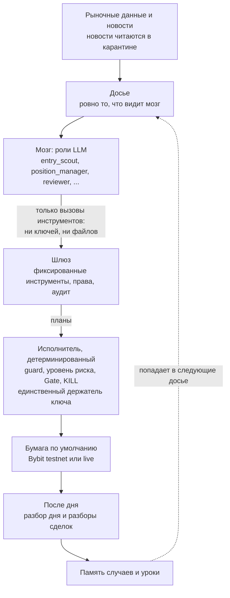

- **Агенты.** Каждая роль это вызов LLM со своим промптом, схемой ответа, бюджетом и запасной моделью. Провайдер любой: DeepSeek и Anthropic нативно, OpenAI-совместимые API (OpenAI, Gemini, Groq, Mistral, OpenRouter) и локальные модели (LM Studio, Ollama). Подробно: `docs/ROLES.md`, `docs/BRAIN.md`, `docs/PROVIDERS.ru.md`.
- **Исполнитель.** Ставит каждую заявку сразу со стопом и тейком, следит за позициями в секундной шкале, размер, плечо и маржу считает код от капитала и уровня риска владельца (1-5). Стоп можно только ужесточить. Без усреднения убытка и мартингейла. `state/KILL` останавливает торговлю, снять его может только человек. Подробно: `docs/ARCHITECTURE.md`, `docs/RISK_LEVELS.md`, `docs/CONTROL.md`.
- **Инструменты, а не доступ.** Мозг не видит ключей, файлов и командной строки: только шлюз инструментов с правами на агента (`docs/GATEWAY.md`). Тексты третьих лиц (новости, заголовки) это данные, а не инструкции (`docs/NEWS.md`).
- **Память и измерение.** Каждая сделка попадает в журнал, гипотезы считаются как эксперименты (n, средний R, поправка на множественные сравнения), случаи и уроки попадают в следующие досье. Куда это движется: `docs/ROADMAP.md`.

## Быстрый старт

Одна команда на каждую ОС. Она проверит среду, предложит поставить недостающее (включая Python), настроит бумажный режим и, по желанию, провайдера LLM, затем запустит платформу и дашборд. Ничего не ставится без явного ответа `[Y/n]`, точная команда показывается заранее.

```bash
git clone https://github.com/ciel69/stoatrade.git
cd stoatrade
./tb setup            # macOS, Linux, WSL
```

```powershell
git clone https://github.com/ciel69/stoatrade.git
cd stoatrade
.\tb.cmd setup        # Windows (cmd или PowerShell)
```

Затем откройте **http://127.0.0.1:8765/** (только локально) и нажмите **«Начать торговлю»** вверху боковой панели, режим `paper`. Дальше: `./tb start`, `./tb stop`, `./tb status` (Windows: `.\tb.cmd ...`).

Что именно проверяет и делает `setup`, флаги `--check`, `--yes`, `--dry-run`, `--no-start`: [docs/QUICKSTART.md](docs/QUICKSTART.md). Коротко о требованиях: Python 3.9+ (поставится сам, если его нет), пакет `websockets` для дашборда (предлагается через pip), доступ к публичному API Bybit. Node.js **не** нужен: собранный дашборд (`frontend/dist`) лежит в репозитории. Ключ биржи для paper не нужен, ключ LLM необязателен.

## Скриншоты

Демо-данные, а не реальный счёт (`frontend/e2e/lib/demo.mjs`; как переснять: `docs/images/README.md`). Скриншоты подстраиваются под тему GitHub (тёмная или светлая).

### Обзор

Полоса денег, запас до лимитов, открытые позиции со стопом и тейком, накопленный PnL, что делает мозг, лимитные заявки, планы в работе.

<picture>
  <source media="(prefers-color-scheme: light)" srcset="docs/images/overview-light.png">
  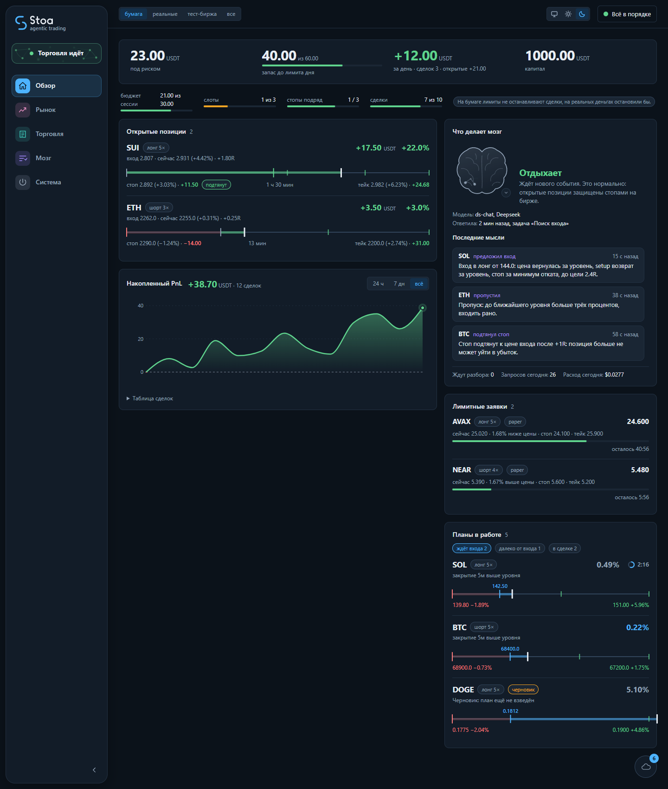
</picture>

### Мозг → Решения

Каждое решение ролей и исполнителя, отказы с причиной, результат по моделям против расхода на ИИ.

<picture>
  <source media="(prefers-color-scheme: light)" srcset="docs/images/brain-decisions-light.png">
  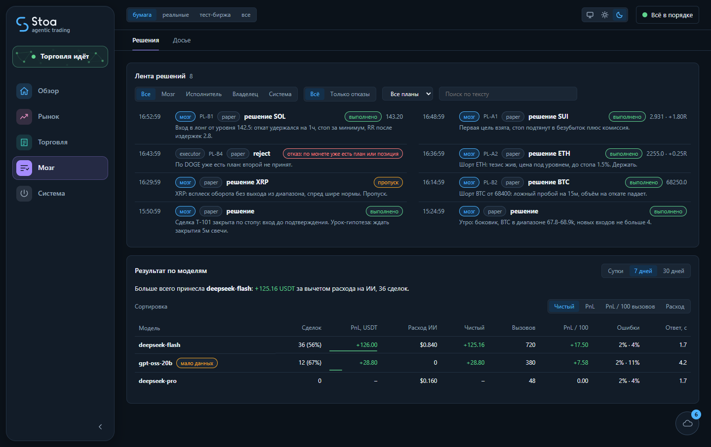
</picture>

### Система → Управление

Состояние платформы, уровень риска, узлы, сессия с бюджетом убытка, запас до каждого лимита, капитал.

<picture>
  <source media="(prefers-color-scheme: light)" srcset="docs/images/control-light.png">
  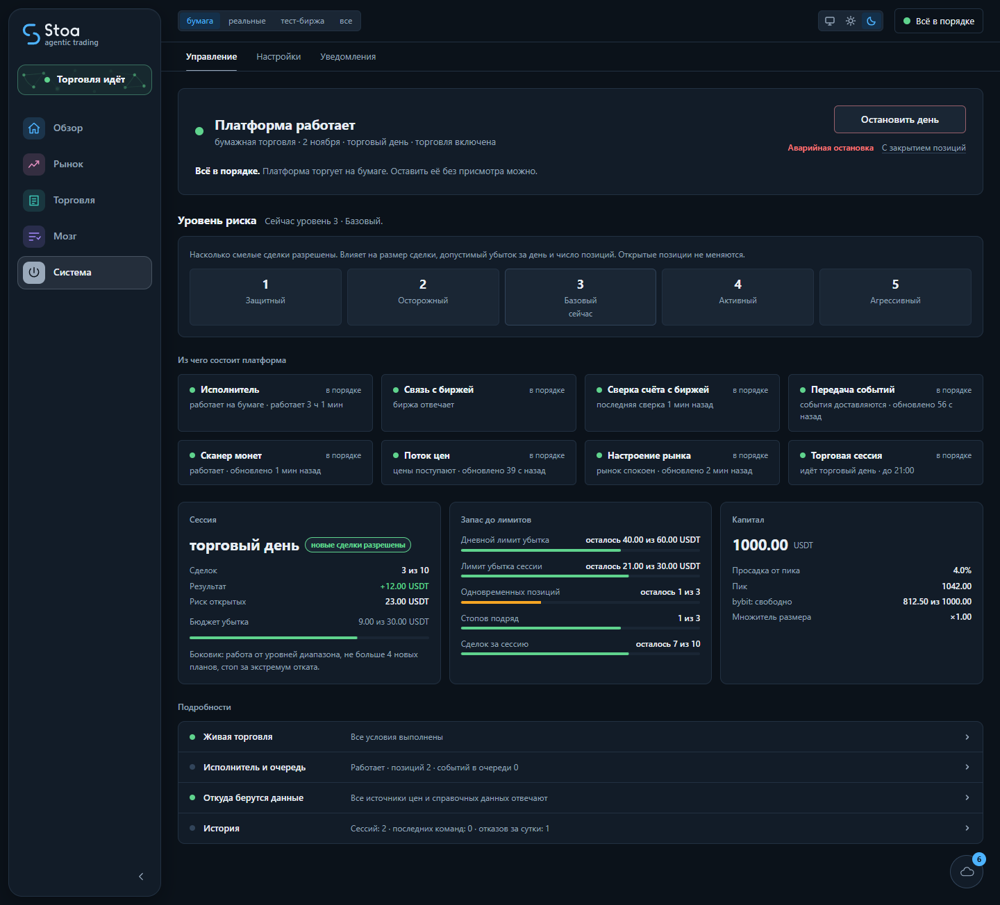
</picture>

<details>
<summary><b>Остальные экраны</b> (8)</summary>

### Торговля → Планы

Ждут входа, далеко, в сделке, закрытые; расстояние до триггера.

<picture>
  <source media="(prefers-color-scheme: light)" srcset="docs/images/plans-light.png">
  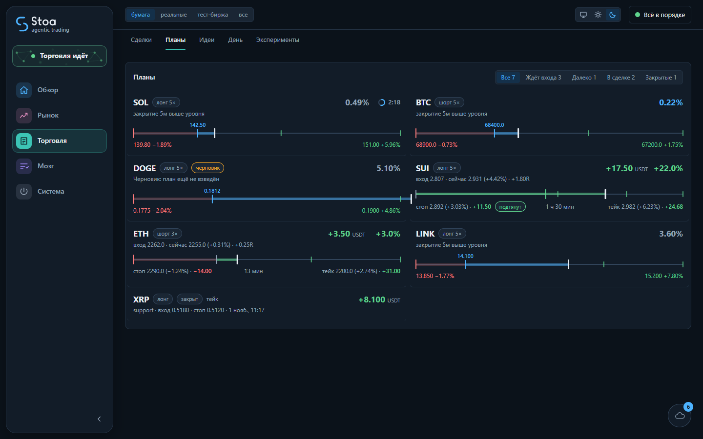
</picture>

### Торговля → Сделки

Накопленный PnL, история, PnL по сделкам, причины выхода, теги ошибок из разбора.

<picture>
  <source media="(prefers-color-scheme: light)" srcset="docs/images/trades-light.png">
  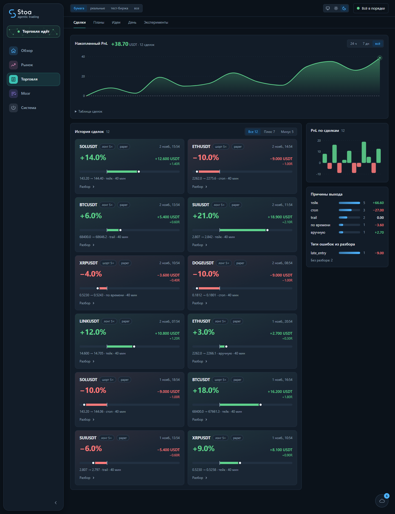
</picture>

### Торговля → День

Шаги запуска торгового дня, план дня, перенесённые позиции, прошлые дни с итогами.

<picture>
  <source media="(prefers-color-scheme: light)" srcset="docs/images/day-light.png">
  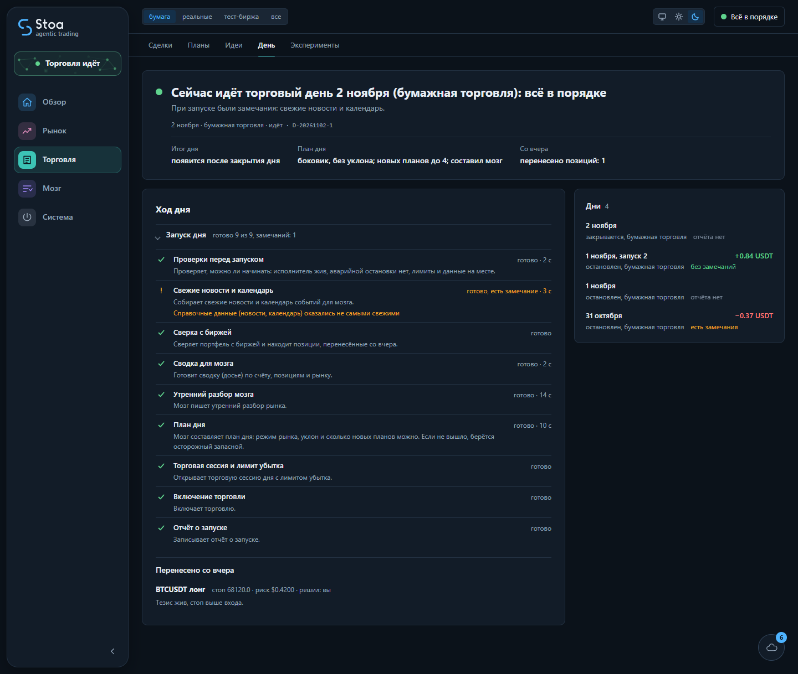
</picture>

### Торговля → Эксперименты

Гипотезы с n, средним R, долей прибыльных и пометкой «мало данных».

<picture>
  <source media="(prefers-color-scheme: light)" srcset="docs/images/experiments-light.png">
  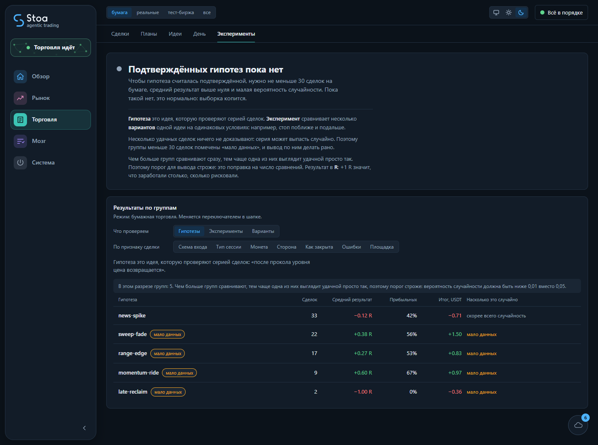
</picture>

### Мозг → Досье

Ровно то, что видит мозг: счёт, запас, позиции, планы, рынок, лимиты, расход LLM за день, горячие монеты, уровни, уроки.

<picture>
  <source media="(prefers-color-scheme: light)" srcset="docs/images/brief-light.png">
  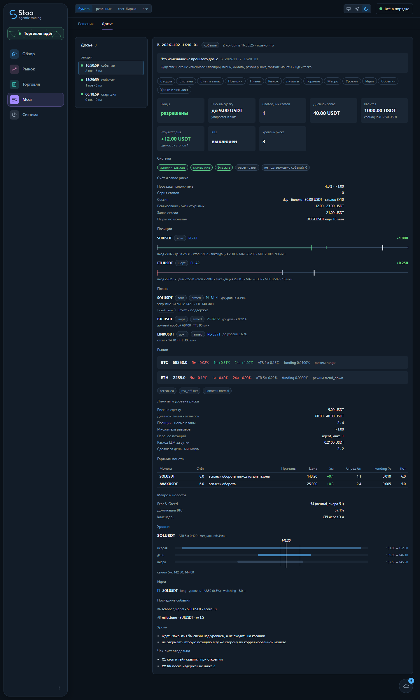
</picture>

### Система → Настройки

Какая модель обслуживает какую роль, провайдеры и биржа, расход LLM и потолки.

<picture>
  <source media="(prefers-color-scheme: light)" srcset="docs/images/settings-light.png">
  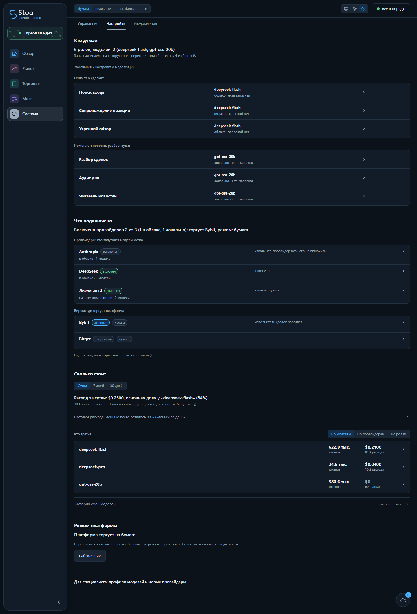
</picture>

### Рынок

Карта монет.

<picture>
  <source media="(prefers-color-scheme: light)" srcset="docs/images/market-light.png">
  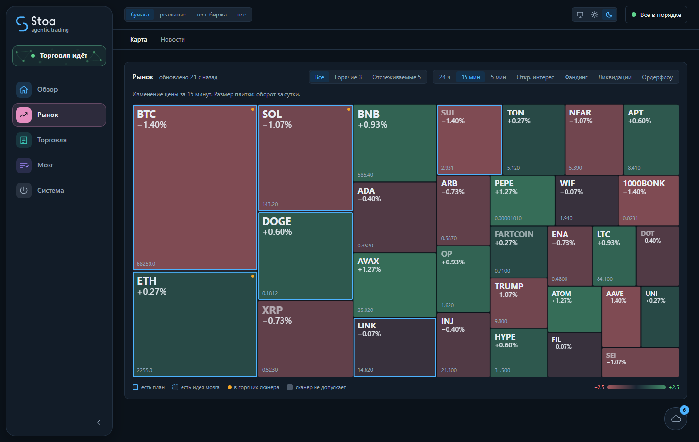
</picture>

### Панель событий

События шины в реальном времени.

<picture>
  <source media="(prefers-color-scheme: light)" srcset="docs/images/events-light.png">
  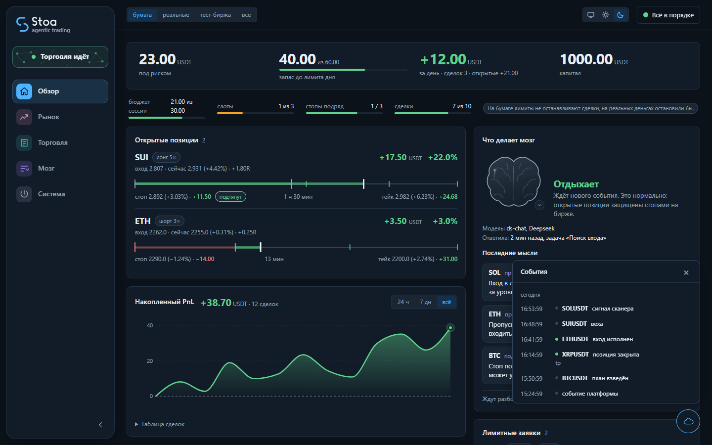
</picture>

</details>

## Документация

| | |
|---|---|
| [docs/QUICKSTART.md](docs/QUICKSTART.md) | первый запуск, `setup`, старт, дашборд, остановка, если что-то не так |
| [docs/PROVIDERS.ru.md](docs/PROVIDERS.ru.md) | подключение провайдера LLM (облачного или локального), профили, роли, бюджеты |
| [docs/EXCHANGES.md](docs/EXCHANGES.md) | ключи биржи (только Bybit), testnet, гейты live |
| [docs/WINDOWS.md](docs/WINDOWS.md) | особенности Windows |
| [docs/ROADMAP.md](docs/ROADMAP.md) | направление развития: обучающийся мозг, этапы 0-6 |
| [docs/INDEX.md](docs/INDEX.md) | всё остальное: архитектура, шлюз, плоскость управления, уровни риска, жизненный цикл, исследования |

Тесты: `./tb test` (unittest, без сети и реальных ключей). Вклад: `CONTRIBUTING.md`; уязвимости: `SECURITY.md`; перед публикацией форка: `./tb audit-public`.

## Отказ от ответственности

- **Экспериментальное ПО. Не финансовая рекомендация.** Ничто здесь не является советом покупать, продавать или держать что-либо.
- **Прибыльность НЕ доказана.** Исследования в репозитории (`docs/RESEARCH.md`) проверили правиловые стратегии и не нашли преимущества, переживающего издержки и проверки на устойчивость. Живой LLM-мозг в деле не проверен. Ценность системы в дисциплине риска и измерении гипотез, а не в обещании дохода.
- **Реальные деньги под риском.** Бессрочные фьючерсы с плечом могут быстро обнулить депозит. Начинайте с профиля `paper` и не торгуйте деньгами, потерю которых не можете себе позволить.
- **ПО предоставляется «как есть», без гарантий** (см. `LICENSE`). Вы сами отвечаете за ключи, настройки и сделки.
- Windows проверялся на реальной машине ограниченно, macOS проверен лучше. Часть источников данных (новости, макро) **не проверена**.

MIT, см. `LICENSE`.
